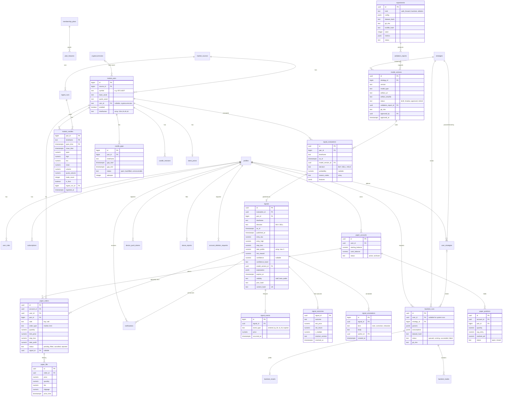

# Entity-relationship diagram

Existing tables are in `supabase/migrations/` (see `docs/DATABASE.md`). Planned
tables are introduced by **new** migrations in the phase shown. Existing
migrations are never edited.

## Planned NEXUS tables (with the existing tables they connect to)

Also planned, but omitted from the diagram for readability:
- `market_sources`, `ingest_runs`, `candle_revisions`, `latest_prices`
- `strategies`, `user_strategies`, `validation_reports`
- `backtest_results` (metrics and downsampled equity curve as jsonb), `backtest_trades`
- `plan_features` (tier × feature key → value)
- `device_push_tokens`, `abuse_reports`, `account_deletion_requests`
- `engine_jobs` (queue: kind, payload, status, run_after, attempts, locked_until)
- `engine_heartbeats` (component, last_seen, details)

## RLS and write intent (planned)

| Table group | anon | user | staff/admin | `nexus_engine` | service role |
|---|---|---|---|---|---|
| sources, pairs, candles, latest_prices | read | read | pairs: admin write (audited, MFA) | write | full |
| gaps, revisions, ingest_runs, heartbeats | — | — | read | write | full |
| strategies, model_versions, validation_reports, experiments | — | approved/summary read | read; approve (MFA) | write drafts | full |
| signal_evaluations | — | — | read | **insert only** | insert only |
| signals, events, outcomes | per `visibility` and tier (D3) | per `visibility` and tier | read | **insert only** | insert only |
| signal_annotations | read (public signals) | read | **insert only** (MFA) | — | insert only |
| backtest_runs/results/trades | — | own; create via quota function (Premium) | read | claim, update status, write results | full |
| user_strategies | — | own CRUD (Premium, schema-validated) | read | read | full |
| paper_accounts/orders | — | own; orders inserted via function (validated) | read | claim/fill/update | full |
| paper_fills, paper_positions | — | read own | read | write | full |
| plan_features | read | read | — | — | write (sync job) |
| device_push_tokens | — | own | — | — | full |
| abuse_reports | — | create; read own | read/update | — | full |
| account_deletion_requests | — | create/read own | read | — | process |
| engine_jobs | — | — | read; enqueue via function (MFA) | claim/update | full |

"Insert only" is enforced by `BEFORE UPDATE OR DELETE` triggers that raise. These
triggers also apply to the service role. RLS tests are added to `tests/db/rls.test.ts`
for each group (CLAUDE.md rule).

## Storage estimate (initial scope)

- Candles: 2 pairs × (35 040 + 8 760 + 2 190 + 365) rows/yr ≈ 93 k rows/yr. A 5-year
  backfill is about 0.5 M rows, under 150 MB with indexes. This fits the Supabase Free tier for development.
- Evaluations: 2 pairs × 127 closes/day ≈ 93 k rows/yr. `features` jsonb is limited
  to the model's feature vector. HOLD evaluations older than 1 year can be aggregated
  (decision before Phase 4 ships; published signals are never aggregated or deleted).
