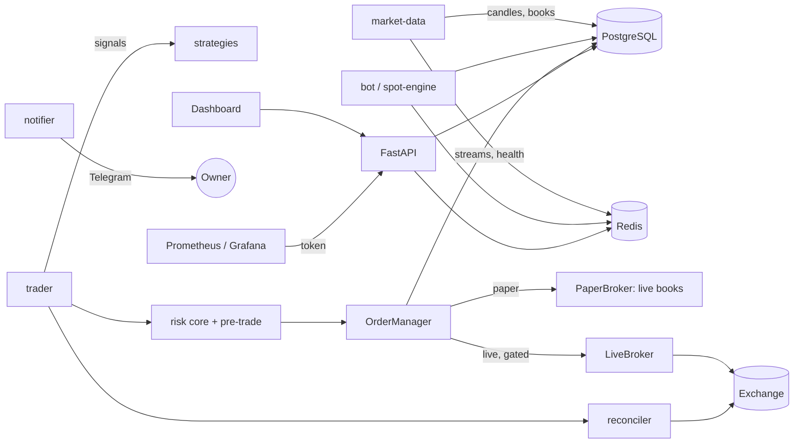

# NEXUS platform architecture (master directive, 2026-11-23)

The seven deliverables of the directive's final instructions, measured against the code
as it is. Companion documents:
* `AUDIT-2026-11-23-multi-exchange.md` (exchange findings);
* `PLATFORM_RESEARCH_2026-11-23.md` (technology research);
* `ROADMAP.md` (history).

## 1. Existing architecture

```
                 Binance / Kraken (REST + WebSocket, via CCXT and a native futures transport)
                                │  central weight gate + circuit breaker (Redis)
┌───────────────────────────────┴───────────────────────────────────────────────┐
│ One Render web service (Frankfurt, 2 GB): FastAPI API + 14 inline workers     │
│   market-data · trader · spot-engine · bot · notifier · news · derivatives    │
│   carry-paper · forward-taker · trend-paper · library-paper · decision-log    │
│   (+ x-sentiment when configured)                                             │
│ Static Next.js dashboard (40 pages) served same-origin                        │
└───────┬──────────────────────────────┬───────────────────────────────────────┘
        │ SQLAlchemy (NUMERIC money)   │ Redis: state, streams, locks, caches
┌───────┴──────────────┐      ┌────────┴──────────┐
│ Supabase PostgreSQL  │      │ Render Key-Value  │
│ (25 tables, RLS,     │      │ (kill switch,     │
│ 18 migrations)       │      │ circuit, streams) │
└──────────────────────┘      └───────────────────┘
```

| Directive module | Implemented by | State |
|---|---|---|
| 1 Exchange Manager | `nexus_exchange` (adapters, capabilities, precision, **capability registry**) | Binance spot (paper and gated live), Binance USD-M (paper), Kraken spot. OKX / Bybit / KuCoin / Gate: detection only |
| 2 Market Data | `nexus_market` (WebSocket-first, REST gap repair, 1m–1d) | ✅ |
| 3 Data Quality | `nexus_market` data-quality report, stale-data gates, closed-bar-only store | ✅ |
| 4 Market Intelligence | `nexus_analysis`, regime classifiers, `nexus_decision` | ✅ |
| 5 Strategy Research | `nexus_strategies`, `nexus_backtest` | ✅ (no validated intraday edge) |
| 6 Strategy Selection | `nexus_decision.selector` / fusion, owner approval | ✅ |
| 7 Machine Learning | `nexus_ai` (purged CV, calibration, registry, drift) | ✅ (no model passed) |
| 8 Portfolio Management | allocator, correlation, exposure, **aggregate open risk** | 🟡 single venue in practice |
| 9 Risk Management | `nexus_risk` (limits, sizing, state machine, kill switch, protections) + `pretrade` | ✅ |
| 10 Smart Order Execution | `OrderManager` (client IDs, IOC / post-only / stop-limit, duplicate guard) | 🟡 no slicing or smart routing |
| 11 Position Management | trader / runner exits (stop, partial, trailing, invalidation, time) | 🟡 stops are not resting on the exchange |
| 12 Backtesting | `nexus_backtest` (event-driven, costs, walk-forward, Monte Carlo, PBO) | ✅ |
| 13 Paper Trading | `PaperBroker` on live books + 5 forward tests | ✅ running |
| 14 Live Trading | `LiveBroker` behind `live_gate` (owner 2FA, config, key test, kill switch) | 🟡 never activated |
| 15 Reconciliation | `BalanceReconciler`, unknown-order recovery by client ID | ✅ |
| 16 Monitoring / Alerts | health endpoints, **Prometheus `/metrics`**, Telegram, structured logs | ✅ (no Sentry; Grafana not hosted) |
| 17 Audit Logging | append-only `audit_logs`, `decision_logs`, ledgers | ✅ |
| 18 Dashboard / API | FastAPI + Next.js | ✅ |

**Operating modes.** The directive's RESEARCH / PAPER / SHADOW / LIVE map to the existing
modes ANALYSIS_ONLY / PAPER_TRADING / SIGNALS_ONLY / LIVE_AUTONOMOUS:
* SIGNALS_ONLY records every decision and its would-be order without placing it, which is
  the directive's SHADOW;
* the bot also has `monitor`.

**Live trading** is never switched on by deploy, restart or configuration alone. It needs
the owner's 2FA approval at most 30 days old.

## 2. Critical bugs and risks (current)

| # | Finding | Severity | Status |
|---|---|---|---|
| 1 | The main risk engine had **no aggregate open-risk limit** (only per-trade risk and exposure) | High | **Fixed today**: 1% of equity, risk to every stop counted, a position without a stop counted in full |
| 2 | Stops are enforced by NEXUS polling, with no resting stop on the exchange: if NEXUS is down, a stop waits | High for live | Open; next phase |
| 3 | The shared Render egress IP gets Binance bans caused by other tenants | High | Mitigated (circuit breaker); the dedicated-IP decision is the owner's |
| 4 | The production key's last test shows spot trading OFF and 0 USDT | Blocking live | The owner must re-test (the live gate now requires it) |
| 5 | Supabase session pool of 15 connections | Medium | Mitigated (small pools, NullPool for slow workers); the reason not to split into many services |
| 6 | No Sentry | Low | Optional (needs a DSN) |
| 7 | Futures are paper only; OKX / Bybit / KuCoin / Gate have no trading adapters | Scope | Roadmap |

No mock or simulated execution is presented as real anywhere. Paper paths are labelled in
the API, the database (`mode`) and the dashboard.

## 3. Target architecture (decision: evolve, do not rewrite)

* **Keep the modular monolith.** One service, separate packages with pure, tested cores,
  Redis Streams as the event bus, PostgreSQL as the durable store.
* **Split workers into separate Render services only when a measured need appears** (CPU,
  memory or isolation). Each split adds database connections to a 15-connection pool.
* **Add exchange adapters behind the existing `ExchangeAdapter` contract.** Each is used
  only after the capability registry and the exchange's testnet / demo prove it.
* **Futures stay a separate subsystem** (`binance_futures`, `futures_sizing`) with their own
  activation switch. The default is 1x isolated.
* **TimescaleDB, Docker-only hosting, Grafana.**
  * Docker Compose already exists for self-hosting (`docker-compose.yml`, 11 services).
  * On Render / Supabase, Timescale is not needed at the current data volume (about 2
    million candle rows).
  * Grafana can scrape `/metrics` with the token.

## 4. Implementation roadmap (the directive's 10 phases)

| Phase | Content | Status |
|---|---|---|
| 1 | Audit, architecture, database, authentication, application health | ✅ **this session**: architecture doc, open-risk limit, `/metrics` |
| 2 | Exchange adapters and live market data | 🟡 registry done; OKX adapter next (spot, then perps), demo-trading first |
| 3 | Strategy framework and indicators | ✅ |
| 4 | Risk engine and sizing | ✅ (aggregate open risk added) |
| 5 | Execution and reconciliation | 🟡 exchange-side protective stop orders next |
| 6 | Backtesting and paper | ✅ |
| 7 | ML and regimes | ✅ (no model validated) |
| 8 | Portfolio optimization and routing | ⬜ after a second trading adapter |
| 9 | Dashboard, alerts, monitoring | ✅ (Grafana dashboard JSON optional) |
| 10 | Security, deployment, recovery, controlled live activation | 🟡 the owner's go-live steps (docs/TRADING_BOT.md) |

## 5. Database schema (25 tables, 18 Alembic migrations)

| Table | Columns | Purpose |
|---|---|---|
| users | 11 | owner / viewer accounts, password hash, 2FA secret (encrypted) |
| exchanges, trading_pairs | 7 / 16 | venues and instrument metadata (tick, step, minimum notional, fees) |
| exchange_credentials | 16 | encrypted API keys, last key test, withdrawal-disabled flag |
| market_candles, orderbook_snapshots, indicators | 11 / 10 / 6 | closed candles 1m–1d, book snapshots, cached indicators |
| strategies, trading_signals | 8 / 17 | strategy rows (validation, owner approval), every signal with its decision |
| portfolios, balances | 8 / 9 | paper and live ledgers per portfolio (internal and reported) |
| orders, trades, positions | 29 / 11 / 20 | client IDs, statuses, fills, fees, stops / targets, exit reasons |
| risk_events, performance_snapshots | 8 / 13 | limit hits, equity and drawdown history |
| ai_models, ai_predictions, model_evaluations | 14 / 13 / 10 | model registry, predictions, evaluations |
| backtest_runs | 15 | stored backtests |
| audit_logs, system_events, decision_logs | 9 / 7 / 20 | append-only audit, events, explained decisions |
| forward_test_events, carry_paper_events | 8 / 7 | append-only forward-test ledgers |

## 6. Service dependency map



Every order passes through risk and pre-trade checks; strategies never place orders.

## 7. Test strategy (current inventory)

* **Unit** (58 files): indicators, strategies (look-ahead and start-up tests on every
  strategy), sizing, limits, protections, pre-trade, settings ceilings, capability
  registry, backtest mechanics, statistics.
* **Integration** (15 files, real PostgreSQL and Redis):
  * the order lifecycle, partial fills, duplicate prevention;
  * a timeout reconciled and never resubmitted;
  * crash and restart recovery, the live gate, the kill switch;
  * bot and trader pipelines, the API (authentication, 2FA, CSRF, metrics).
* **End-to-end:** 15 Playwright tests, desktop and 360 px.
* **Live read-only exchange tests** (`-m live_exchange`) run only on request.
* **Not done:** testnet order round trips in CI. Exchange testnets need keys; the
  supervised testnet order (F2) is an owner step.
* Every change runs `scripts/test.sh` (ruff, strict mypy, pytest). This session: see
  ROADMAP.

## Decisions (ADR log)

| Date | Decision | Why |
|---|---|---|
| 2026-11-23 | Native NEXUS, not Freqtrade | every pipeline stage already exists; avoids duplicate state, risk and keys |
| 2026-11-23 | Keep the monolith with inline workers | Supabase 15-connection pool; no measured CPU need |
| 2026-11-23 | Aggregate open risk is 1% of equity; a position without a stop counts in full | directive Part 8; conservative when a stop is missing |
| 2026-11-23 | `/metrics` only with a bearer token; health data only | monitoring without exposing balances or keys |
| 2026-11-23 | Futures default 1x isolated, separate activation | directive Parts 8 and 10 |
